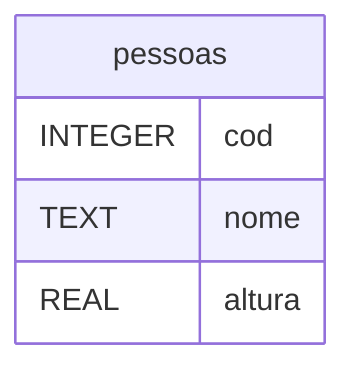

# Fase 18

## Tópicos abordados na Aula

- 00:00 - O que vamos aprender: CRUD, banco de dados e Python
- 01:03 - Apresentação da Aula 18: CRUD com SQLite e Python
- 02:03 - Faetec: cursos técnicos gratuitos na área de tecnologia
- 03:28 - Revisão do conteúdo anterior e introdução ao CRUD
- 04:02 - O significado de CRUD: Create, Read, Update e Delete
- 04:49 - Planejando o sistema de cadastro com Python e SQLite
- 05:16 - Criando o banco cadastro.db e a tabela pessoas
- 05:59 - Planejando o menu e as funcionalidades do sistema
- 06:22 - Preparando o projeto e criando o exercício 019 no PyCharm
- 07:30 - Criando o arquivo main.py e a função principal
- 08:02 - Desenvolvendo a função para exibir o menu
- 08:42 - Criando o loop principal com while
- 09:05 - Controlando as opções do menu com match e case
- 09:40 - Encerrando o sistema com break e tratando opções inválidas
- 10:08 - Adicionando uma pausa para continuar a execução
- 10:49 - Testando o menu e suas opções
- 11:48 - Separando a interface do acesso ao banco de dados
- 12:03 - Criando o arquivo crud.py e importando sqlite3
- 12:35 - Organização do código e arquitetura do sistema
- 13:18 - Criando a função para criar o banco de dados
- 14:10 - Tratando erros com try e except no SQLite
- 15:19 - Conectando ao banco com sqlite3.connect()
- 15:54 - Criando o cursor e executando comandos SQL
- 16:20 - Criando a tabela pessoas com CREATE TABLE IF NOT EXISTS
- 17:07 - Definindo a chave primária e o campo autoincrementável
- 17:59 - Criando os campos nome e altura
- 19:17 - Executando o comando SQL pelo Python
- 19:43 - Entendendo os comandos commit e rollback
- 20:51 - Testando a criação automática do banco de dados
- 21:15 - Importando as funções do arquivo crud.py
- 22:05 - Tratando falhas na criação do banco de dados
- 22:54 - Executando o programa e verificando o arquivo cadastro.db
- 23:57 - Organizando o projeto para as próximas etapas
- 24:14 - Criando as funções do CRUD
- 24:52 - Preparando o tratamento de erros das funcionalidades
- 26:00 - Testando as opções do menu
- 26:35 - Revisando a estrutura do arquivo main.py
- 26:57 - Revisando o arquivo crud.py e suas funções
- 27:21 - Resumo da aula e preparação para a próxima etapa
- 27:53 - Revisando os conceitos de Python e POO
- 28:34 - Encerramento e continuação do projeto CRUD

---

## Perguntas:

- Como **criar** um **pequeno sistema** com **banco de dados**?
- Como **criar** um **banco de dados** via código?
- O que é um **CRUD**?
- Como **criar** um **CRUD** em **Python**?

---

## Fase 18 - CRUD com SQLite em Python - Parte 1

- Create
- Read
- Update
- Delete

---

### Banco de Dados: cadastro.db



---

```plaintext
===========================
    SISTEMA DE CADASTRO
===========================
1 - Cadastrar pessoa
2 - Listar pessoas
3 - Atualizar pessoa
4 - Excluir pessoa
5 - Busca por nome
0 - Sair
===========================

Escolha uma opção: ______
```