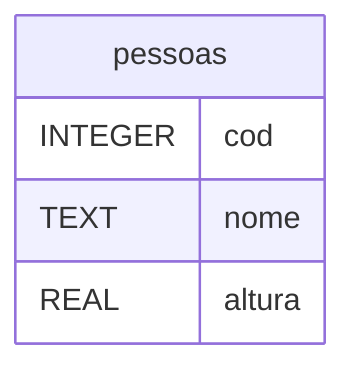

# Fase 19

## Tópicos abordados na Aula

- 00:00 - Cadastro em massa e individual com Python e SQLite
- 01:08 - CRUD: operação Create e inserção de dados
- 02:11 - Patrocínio: Estudonauta
- 03:19 - SQL: INSERT INTO, VALUES e AUTOINCREMENT
- 04:42 - Inserindo múltiplos registros no SQLite
- 05:23 - Commit, rollback e gerenciamento com with
- 06:22 - Criando a função de cadastro em massa
- 07:35 - Preparando os dados com listas e tuplas
- 08:44 - Conexão SQLite e tratamento de erros
- 09:44 - Parâmetros SQL e prevenção contra SQL Injection
- 10:15 - Inserção em lote com executemany()
- 11:02 - Executando e verificando o cadastro em massa
- 12:33 - Diferença entre execute() e executemany()
- 12:49 - Criando a função de cadastro individual
- 13:40 - Validação de dados com strip(), replace() e float()
- 14:57 - Conversão de valores e tratamento de ValueError
- 15:30 - Validando a altura antes de cadastrar
- 16:02 - Retorno de funções com True e False
- 17:05 - Tratamento de erros com sqlite3.Error
- 17:31 - Inserindo dados com INSERT INTO e execute()
- 18:26 - Testando o cadastro e as validações
- 19:23 - Corrigindo o comando SQL INSERT INTO
- 20:04 - Confirmando o cadastro no banco de dados
- 21:33 - Resolvendo o erro database is locked
- 22:15 - Revisão do cadastro em massa e individual
- 23:00 - Testando altura com vírgula decimal
- 24:04 - Experience Podcast
- 24:37 - Conclusão: cadastro de pessoas com SQLite
- 24:48 - Próxima aula: listagem e busca de pessoas

---

## Perguntas:

- Como **cadastrar** **registros em massa** no banco de dados?
- Como **cadastrar** um **novo registro** na tabela?

--- 

## Fase 19 - CRUD com SQLite em Python - Parte 2

- Create
- Read
- Update
- Delete

---

### Banco de Dados: cadastro.db



---

```sql
INSERT INTO pessoas (
    (cod, nome, altura)
VALUES
    ('1', 'Gustavo', '1.84'),
    ('2', 'Gabriela', '1.63'),
    ('3', 'Marcos', '2.02');
)
```
